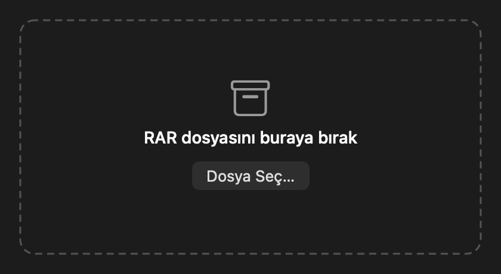
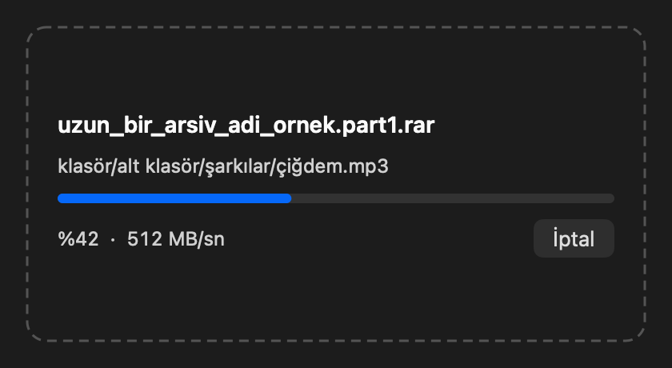

# RarAç

`.rar` dosyasına çift tıkla, dosyaların yanına açılsın. macOS için küçük ve yerel bir RAR açıcı.

<p>
  
  
</p>

Reklam yok, deneme süresi yok, ağ bağlantısı yok. Derlenmiş uygulama yaklaşık 540 KB.

## Özellikler

- **Tek adımda açma:** Çift tıkla veya pencereye sürükle. Sonuç Finder'da gösterilir.
- **RAR4 ve RAR5:** İki sürümü de açar.
- **Şifreli arşivler:** Şifreyi sorar, yanlışsa tekrar dener.
- **Çok parçalı arşivler:** `.part1.rar` ve `.r00` biçimlerinde hangi parçayı açarsan aç, baştan birleştirir. Eksik parçayı adıyla söyler.
- **Düzenli çıktı:** Tek üst öğe varsa ekstra klasör oluşturmaz, birden çoksa arşiv adıyla klasör açar.
- **Veri güvenliği:** Var olan dosyanın üzerine yazmaz (`rapor 2.txt` gibi yeni ad kullanır). Dosyalar önce gizli bir geçici klasöre yazılır, bu yüzden hata veya iptalde yarım dosya kalmaz.
- **Hızlı:** Çok çekirdekli açma kullanır, arayüz saniyede en fazla 10 kez güncellenir.

## Kurulum

Hazır bir sürüm yayınlanmıyor, kaynaktan derlenir. Gereksinimler: Apple Silicon Mac, macOS 13 veya üstü, Xcode Komut Satırı Araçları.

```bash
git clone https://github.com/IbrahimTalha0/open_rar_for_macos.git
```

```bash
cd open_rar_for_macos && ./build.sh
```

Uygulama `build/RarAc.app` konumunda oluşur. İstersen Uygulamalar klasörüne taşı. Derleme betiği uygulamayı ücretsiz yerel imzayla (ad-hoc) imzalar, Apple geliştirici hesabı gerekmez.

Başka bir RAR uygulaman varsa çift tıklama ona gidebilir. Bir `.rar` dosyasında **Bilgi Al → Birlikte Aç → RarAç → Tümünü Değiştir** yolunu izle.

## Güvenlik

Arşiv dosyaları güvenilmeyen veri sayılır:

- Arşiv içindeki `../` ve mutlak yollar çıktı klasörünün içine çevrilir.
- Klasör dışını gösteren sembolik bağlantılar atlanır ve kaç tanesinin atlandığı bildirilir.
- İnternetten inen arşivin karantina etiketi açılan dosyalara taşınır, böylece macOS içindeki uygulamaları denetlemeye devam eder.
- Çok büyük bellek isteyen arşivler reddedilir.
- Şifreler diske yazılmaz, yalnızca işlem sırasında bellekte tutulur.
- Kurtarma hacmi (`.rev`) kodu derlemeye dahil değildir.

RarAç bir virüs tarayıcısı değildir. Arşivden çıkan programlara, kaynağına güvenmiyorsan çalıştırma.

## Bilinen sınırlar

- Yalnızca açar, RAR oluşturmaz.
- Intel Mac'ler için derlenmiyor.
- UnRAR kaynağı şu an **7.30 beta 2** sürümünde, çünkü RARLAB'ın indirme sayfasında yalnızca bu kaynak sunuluyor.
- Sürükle-bırak, "Dosya Seç" ve İptal düğmesi otomatik testlerin kapsamında değil.

## Testler

```bash
swiftc -target arm64-apple-macos13.0 -swift-version 5 -O -wmo -import-objc-header Sources/CRarAc/rarac_shim.h Sources/App/RarExtractor.swift tests/cli/main.swift build/rarac_shim.o build/obj/libunrar.a -lc++ -o build/engine-cli
```

```bash
python3 -I tests/run_tests.py "$PWD/build/engine-cli" "$(mktemp -d)/tests"
```

Testler RAR4, RAR5, şifre, çok parça, bozuk arşiv, klasör dışına yazma denemeleri, karantina etiketi ve iptal durumlarını kapsar. Test arşivleri sıkıştırmasız olarak elle üretilir, çünkü RAR oluşturmak için ücretli `rar` aracı gerekir.

## Proje yapısı

| Konum | İçerik |
|---|---|
| `Sources/App/main.swift` | AppKit arayüzü |
| `Sources/App/RarExtractor.swift` | Ayıklama akışı, şifre ve hata yönetimi |
| `Sources/CRarAc/` | Swift ile UnRAR arasındaki C++ köprüsü |
| `vendor/unrar/` | Değiştirilmemiş UnRAR kaynak kodu |
| `tests/` | Uçtan uca motor testleri |

## Lisans ve teşekkür

`vendor/unrar` dışındaki kod [MIT lisansıyla](LICENSE) sunulur: Telif bildirimini koruduğun sürece kullanabilir, değiştirebilir, dağıtabilir ve satabilirsin.

RAR açma işi [RARLAB](https://www.rarlab.com/rar_add.htm)'ın UnRAR kaynak koduyla yapılır. `vendor/unrar` MIT kapsamında değildir. Kod Alexander Roshal'a aittir ve [vendor/unrar/license.txt](vendor/unrar/license.txt) koşullarıyla dağıtılır. Bu lisans, kodun RAR sıkıştırma algoritmasını yeniden oluşturmak için kullanılmasına izin vermez.
